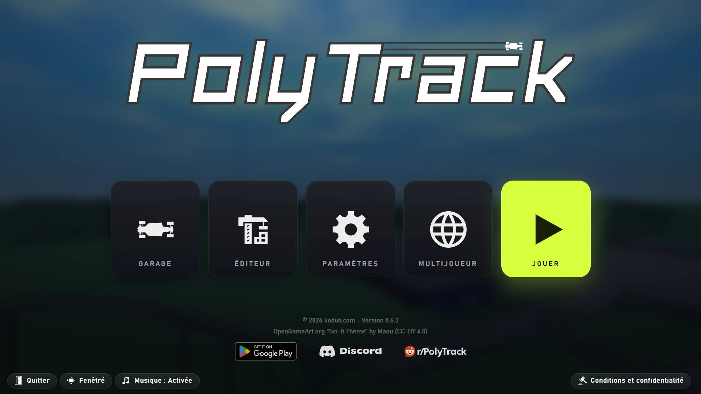
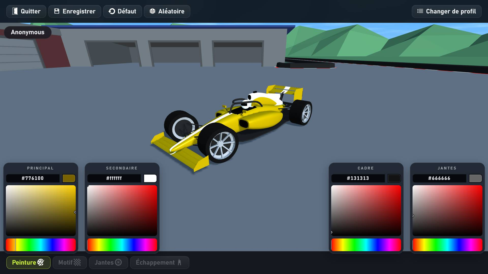
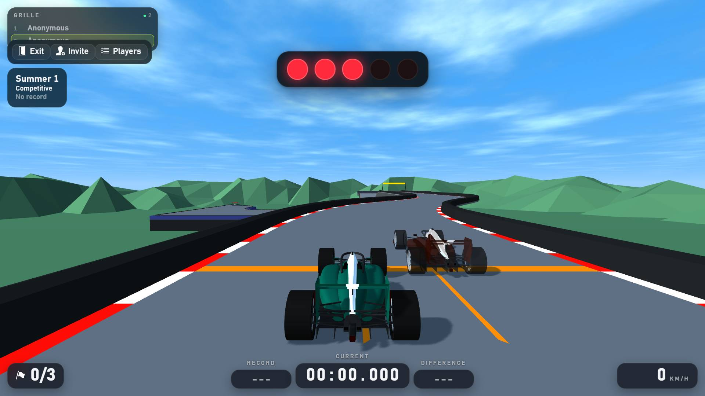

# GoofyTrack

Jeu de course pour Windows, construit sur [PolyTrack](https://www.kodub.com) 0.6.3. Tout tient dans ce dossier : le jeu (`GoofyTrack.exe`) et sa mise à jour.

> Projet de fan, non affilié à Kodub. Ce dépôt ne contient aucun fichier de PolyTrack : la première installation copie votre propre PolyTrack dans ce dossier et le transforme en GoofyTrack.

**Version actuelle : 2.14** 
Le détail de chaque version est dans les [patch notes](PATCHNOTES.md).



## Ce que ça change

**Voiture**
- Nouvelles Carrosseries de F1
- Nouvelles personnalisations : 16 livrées redessinées pour la nouvelle carrosserie



**Interface « Apex »**
- Interfaces améliorées
- Les couleurs, rayons et ombres sont des variables en tête de `apex-theme.css`.

**Graphismes**
- Ombres plus douces et un peu plus marquées.
- Ciel plus profond avec un halo autour du soleil, nuages plus lumineux.
- Pièces de piste ombrées en lissé : virages, pentes, loopings, barrières et piliers n'ont plus de facettes visibles. Seul l'ombrage change, calculé une fois au chargement ; la géométrie, qui sert aussi aux collisions, reste identique.
- Ambiances au choix depuis l'écran d'accueil (jour, heure dorée, crépuscule, couvert) : seules les couleurs du ciel et de la lumière changent, sans coût en performance.
- Montagnes redessinées : relief plus fin, chaîne lointaine, roche, neige, forêts de sapins ou rochers selon l'environnement (`apex-scenery.js`).
- Ces changements ne touchent ni les voitures ni la physique. Les réglages sont en tête de `apex-gfx.js` et `apex-scenery.js`.

**Aides au pilotage** (solo et multijoueur)
- Mini-carte : le tracé de la piste, votre voiture en flèche et, dans une room, les autres joueurs en points. La touche M (réglable dans Paramètres > Contrôles) l'affiche ou la masque.
- Les touches portent le nom de celles de votre clavier : en AZERTY, on accélère avec Z et on tourne avec Q et D.
- Le bouton **Paramètres** de la barre en haut à gauche ouvre les réglages pendant une partie, en solo comme dans une room : touches, graphismes, son, sans quitter la piste.
- Écart en direct : pendant le tour, votre avance ou votre retard sur votre meilleur tour de la session, mesuré en continu le long de la piste et pas seulement aux points de contrôle.

**Multijoueur**
- Liste des rooms : l'écran Multijoueur affiche les rooms ouvertes (hôte, piste, mode, joueurs) ; un clic sur « Rejoindre » suffit, sans code. Le code d'invitation reste possible en dessous, et l'hôte peut garder sa room hors de la liste.
- Tableau des 5 meilleurs temps de la room, affiché pendant la course.
- Fantôme du meilleur tour vu dans la room, rejoué à côté de vous.
- Les rooms passent par le serveur GoofyTrack (voir plus bas) : un code d'invitation reste valable tant que l'hôte est dans la room, et seuls les joueurs qui ont exactement le même build du mod peuvent la rejoindre.

**Environnement Riviera**
- Un quatrième environnement, à côté d'Été, Hiver et Désert, à choisir dans l'éditeur (Réglages de la piste > Environnement) : la côte méditerranéenne de Monaco GP pour n'importe quelle piste.

**Circuits**
- Une catégorie « Circuits », en tête des pistes officielles, avec Killer Loop et **Monaco GP** : le vrai tracé du Grand Prix de Monaco, à l'échelle (3,3 km, 35 m de dénivelé), au milieu de la principauté en low poly.
- **Montbéliard** : la boucle des boulevards autour de la vieille ville (1,8 km), sur le vrai plan du centre : chaque bâtiment est à sa place, avec le château des ducs de Wurtemberg sur son rocher, le temple Saint-Martin, les halles, la gare, l'Allan et le canal.
- **Spa-Francorchamps** : le circuit du Grand Prix de Belgique à l'échelle (7 km), avec son vrai relief : la descente vers l'Eau Rouge, le Raidillon, la montée de Kemmel jusqu'aux Combes, 100 m plus haut que Stavelot. Forêts des Ardennes, stands et tribunes à leur place.
- **Strasbourg** : le tour des quais de la Grande Île (4 km), l'Ill tout autour, la cathédrale et sa flèche de 142 m au milieu, les Ponts Couverts et leurs tours, la place de la République.
- **Dijon** : le tour des boulevards de la vieille ville (4,4 km) : place Darcy et la porte Guillaume, la République, le boulevard Carnot ; au centre, le palais des Ducs et la tour Philippe le Bon, Saint-Bénigne et son toit de tuiles vernissées.
- **Goofy Coaster** : un grand huit de 3,7 km dessiné dans le vide, pour s'amuser : grande descente, looping, sauts, virage relevé à 72°, tire-bouchon, vagues et dos de chameau.
- Ces pistes ont leur propre classement en ligne, partagé entre tous les joueurs du mod et tenu par le serveur GoofyTrack : records, position, fantômes et replays comme sur les pistes officielles.

**Profil et compte GoofyTrack**
- Badge de profil en haut à gauche du menu principal : votre voiture (redessinée à chaque changement de livrée), votre drapeau, votre pseudo et l'état du compte. Un clic ouvre la carte du profil : pistes bouclées, circuits du mod, meilleure place en ligne sur ces circuits, pistes perso, garage. C'est là qu'on change de pseudo et de drapeau (« Modifier le profil ») et de profil (« Changer de profil », import compris).
- Garage : il ne s'occupe que de la voiture. Le bouton « Livrées » garde trois designs par profil : choisir une livrée la met sur la voiture, « Enregistrer » y garde les modifications, les deux autres sont garées à côté (`apex-livery.js`). Chaque motif a un nom et une rareté (Commun gris, Rare vert, Très rare bleu, Épique violet, Légendaire jaune, Mythique rouge) qui fait le cadre de sa tuile (`apex-rarity.js`) ; le motif légendaire Monaco GP Edition est un motif du mod (`build_patterns.js`, ajouté à la liste du jeu par `patch_bundle.js`).
- Depuis cette carte, avec un pseudo et un mot de passe, vos profils, records et fantômes, pistes perso et réglages vous suivent sur chaque PC où vous vous connectez.
- Chaque compte a un numéro de joueur (#0001, #0002…). Onglet **Amis** : ajoutez vos amis par leur numéro, voyez qui est en ligne, et rejoignez en un clic la room où se trouve un ami, qu'il l'héberge ou qu'il l'ait rejointe.
- Sur la page d'une map, le nom du créateur ouvre sa fiche de joueur quand un compte porte ce nom : stats, meilleure place, circuits créés, ajout en ami.
- La sauvegarde est fusionnée à la connexion (le meilleur temps de chaque piste est gardé), puis synchronisée toute seule. Elle est chiffrée avec votre mot de passe : le serveur ne peut pas la lire, et un mot de passe oublié ne se réinitialise pas. Détails dans les [patch notes V2.13](PATCHNOTES.md) et dans [Comptes](#comptes).

**Collisions entre voitures**
- Dans une room « Course », les voitures sont solides les unes pour les autres, en permanence : essais libres, qualifications, tour de formation et course. On se pousse, on se bloque, un choc à l'arrière propulse la voiture de devant, un choc de côté fait tourner.
- « Collisions activées » s'affiche sous le classement de la room. Pas de collisions dans les rooms Casual et Compétitif.
- Détails et limites dans les patch notes [V2.4](PATCHNOTES.md#v24--collisions-entre-voitures) et dans les [limites connues](#limites-connues).

**Mode course**

Sur l'écran « Héberger », un troisième mode **Course** s'ajoute à Casual et Competitive, avec ses options : nombre de tours (1 à 20), qualifications et tour de formation. L'hôte peut encore les changer dans la room, entre deux courses. Une course enchaîne :

1. **Entraînement** : chacun roule librement, le tableau affiche les 5 meilleurs temps.
2. **Qualifications** (optionnel) : tours chronométrés libres depuis le départ, le meilleur de chacun compte. L'hôte passe à la suite quand il veut.
3. **Tour de formation** (optionnel) : un tour non chronométré depuis la grille. La course part quand tout le monde l'a bouclé (ou quand l'hôte la lance).
4. **Course** : grille dans l'ordre des qualifications (ou des temps de la room), où chaque voiture part réellement de son emplacement, cinq feux rouges, puis N tours. Le tableau donne le classement en direct (tour en cours, écarts) et un bandeau affiche votre tour et votre dernier temps au tour.
5. **Résultats** : classement final, puis retour à l'entraînement.

Les courses en plusieurs tours demandent un **circuit** : une piste dont la ligne d'arrivée est posée juste derrière le départ (à moins de 50 m), avec ses checkpoints sur le tour. Sur une piste qui ne boucle pas, la course se fait en un seul tour. Le mod ajoute une catégorie **Circuits** en tête des pistes officielles, avec le circuit « Killer Loop », un rectangle en route large ([`tracks/killer_loop.track`](tracks/killer_loop.track), généré par [`tracks/make_loop_track.js`](tracks/make_loop_track.js)). Les pistes du mod sont déclarées dans [`tracks/index.js`](tracks/index.js) ; le classement en ligne du jeu ne les connaît pas, leurs records vont donc au [serveur GoofyTrack](#classements-des-circuits-du-mod).



## Patch notes

Le détail de chaque version est dans [PATCHNOTES.md](PATCHNOTES.md), et dans le jeu avec le bouton **Patch notes** du menu principal.

## Installation

Il faut [Node.js](https://nodejs.org) 18 ou plus récent et PolyTrack 0.6.3 pour Windows.

```bash
git clone https://github.com/galmichedany7-jpg/goofytrackv1.git GoofyTrack
cd GoofyTrack
node build.js "C:\chemin\vers\PolyTrack-v0.6.3-win32-x64"
```

Ensuite, lancez **`GoofyTrack.exe`**, dans ce même dossier.

La première fois, PolyTrack est copié dans ce dossier (fichiers ignorés par git) : `PolyTrack.exe` devient `GoofyTrack.exe`, avec l'icône et le nom de GoofyTrack ([`setup.js`](setup.js)). Le dossier de PolyTrack n'est plus utilisé ensuite, vous pouvez le supprimer. S'il est à côté de ce dossier, il est trouvé tout seul et `node build.js` suffit. Vos sauvegardes (temps, pistes, réglages) restent celles de PolyTrack.

L'archive d'origine du jeu est gardée sous le nom `resources/app.asar.original` et décompressée dans `resources/app`, que le jeu charge à la place. Relancer `node build.js` reconstruit tout à partir de l'archive d'origine : c'est aussi la commande à utiliser après avoir modifié le code (jeu fermé).

Pour désinstaller, supprimez le dossier.

### Mises à jour automatiques

Double-cliquez sur **`Jouer a GoofyTrack.bat`** au lieu de `GoofyTrack.exe` : il récupère la nouvelle version s'il y en a une, reconstruit le jeu si besoin, puis le lance. **`Mettre a jour GoofyTrack.bat`** fait la même chose sans lancer le jeu. En ligne de commande :

```bash
node update.js [--check] [--play] [--force]
```

- Dossier cloné avec git : `git pull` (les derniers commits) avec vos identifiants git, refusé s'il y a des modifications locales.
- Dossier téléchargé en ZIP : le code de la dernière release est copié par-dessus le dossier. Le dépôt étant privé, le premier lancement demande un token GitHub en lecture seule (Contents > Read-only sur ce dépôt), gardé dans `update-settings.json`.
- Sans connexion, le jeu se lance quand même.
- Venant d'une version où le mod était installé dans le dossier de PolyTrack : la mise à jour copie le jeu dans ce dossier la première fois (le dossier de PolyTrack est retrouvé ou demandé).

Pour les releases : le tag doit être `V` + `MOD_VERSION` de `config.js` (`V2.7` pour `2.7`), c'est lui qui est comparé à la version installée.

## Compatibilité en ligne

- **Classements officiels** : hors course, la physique n'est pas modifiée, vos temps en solo et en room restent comparables à ceux des autres joueurs. Les temps faits pendant une course (qualifications, formation, course) ne sont ni enregistrés ni envoyés.
- **Pistes du mod** : leurs records vont au serveur GoofyTrack, jamais au classement officiel.
- **Rooms** : le mod n'utilise plus les serveurs de PolyTrack pour le multijoueur, seulement pour les classements. Les joueurs sans le mod (ou avec un autre build) ne peuvent donc pas rejoindre une room GoofyTrack, et un joueur GoofyTrack ne peut pas rejoindre une room du jeu d'origine.
- **Jeu modifié** : le jeu d'origine refuse le multijoueur s'il détecte une physique ou des fichiers modifiés. Le mod lève ce blocage pour ses propres rooms : vous pouvez changer le jeu comme vous voulez, du moment que tous les joueurs installent le même build.

## Serveur multijoueur

La partie elle-même se joue en pair-à-pair (WebRTC entre l'hôte et chaque joueur). Un serveur ne sert qu'à distribuer les codes d'invitation et à mettre en relation l'hôte et les joueurs qui le rejoignent. Le mod utilise le sien, dans [`server/`](server/server.js) : un petit programme Node qui parle le même protocole que celui de PolyTrack.

- **Codes** : six caractères (sans 0/O ni 1/I), valables tant que l'hôte reste connecté. Minuscules, espaces et tirets sont acceptés à la saisie.
- **Liste des rooms** ([`apex-lobby.js`](apex-lobby.js)) : le jeu qui héberge envoie toutes les 3 s, sur sa connexion au serveur, ce que la liste montre de la room (`roomInfo` : hôte, piste, mode, joueurs, phase de course, visible ou non). `GET /rooms?mod=<build>` rend les rooms visibles de ce build ; l'écran Multijoueur l'interroge toutes les 4 s et rejoint une room en remplissant son code à la place du joueur.
- **Build** : à chaque `node build.js`, une empreinte des fichiers du mod est calculée (affichée par le build, et dans l'infobulle de la première ligne en bas du menu). Le serveur refuse un joueur dont l'empreinte diffère de celle de l'hôte, avec un message clair dans le jeu. Après une modification, tout le monde doit donc refaire `node build.js` avec les mêmes fichiers.
- **Adresse** : `SERVER_URL` dans [`config.js`](config.js). La variable d'environnement `GOOFY_SERVER` la remplace le temps d'un build (par exemple `http://localhost:8787/` pour un test local).

### Mettre le serveur en ligne (Render, gratuit)

1. Poussez ce dépôt sur GitHub.
2. Sur [render.com](https://render.com), créez un compte, puis **New > Blueprint** et choisissez le dépôt : le fichier [`render.yaml`](render.yaml) décrit le service (dossier `server/`, offre gratuite).
3. Une fois le service déployé, copiez son adresse (`https://<nom>.onrender.com/`, avec la barre oblique finale) dans `SERVER_URL` de `config.js`, puis relancez `node build.js` chez chaque joueur.

Sur l'offre gratuite, le serveur s'endort après 15 minutes sans connexion et met jusqu'à une minute à se réveiller. Le jeu l'appelle dès son lancement pour qu'il soit prêt quand vous ouvrez le multijoueur. Une room déjà ouverte n'est pas concernée : la connexion de l'hôte le garde éveillé.

### Classements des circuits du mod

Le serveur tient aussi les classements des pistes du mod ([`server/records.js`](server/records.js)) : un record par joueur et par piste, son meilleur temps, avec le replay. Le jeu les interroge avec les mêmes requêtes que le classement officiel ; un record ne compte que s'il vient du même joueur que les précédents (signature tirée de son jeton PolyTrack).

Sur l'offre gratuite de Render, le disque est effacé à chaque redémarrage. Pour garder les records, le serveur les écrit dans un **Gist secret** de votre compte GitHub :

1. Sur GitHub, **Settings > Developer settings > Personal access tokens > Tokens (classic) > Generate new token**, en ne cochant que **gist**, sans date d'expiration (ou en pensant à le renouveler).
2. Sur Render, dans le service, **Environment** : ajoutez la variable `GITHUB_TOKEN` avec ce jeton, puis redéployez.

Au démarrage, le serveur retrouve son Gist (« GoofyTrack records », fichier `goofytrack-records.json`) ou le crée. Les records arrivent quelques secondes après le réveil du serveur et sont enregistrés au plus 5 secondes après chaque nouveau temps. Sans `GITHUB_TOKEN`, ils vont dans `server/records.json` (pratique en local). Le serveur ne rejoue pas les tours : comme entre amis, on fait confiance aux temps envoyés.

### Comptes

Le serveur garde aussi la sauvegarde de chaque compte ([`server/accounts.js`](server/accounts.js), côté jeu [`apex-account.js`](apex-account.js)), avec le même `GITHUB_TOKEN`, dans un second Gist secret (« GoofyTrack accounts », un fichier par compte). Sans `GITHUB_TOKEN`, ils vont dans `server/accounts.json`. **Sur Render, sans `GITHUB_TOKEN`, les comptes sont effacés à chaque mise en veille** (la page `/health` dit où ils sont gardés).

- **Mot de passe** : il ne quitte jamais le PC. Le jeu en tire deux clés (PBKDF2, 310 000 tours) : l'une chiffre la sauvegarde (AES-GCM, après compression), l'autre sert à se connecter et le serveur n'en garde qu'une empreinte (scrypt). Le serveur ne stocke donc qu'un bloc illisible, et ne peut pas réinitialiser un mot de passe.
- **Sauvegarde** : une liste d'entrées (profil, record, piste perso, réglage), chacune avec l'heure de sa dernière modification. Une suppression reste dans la liste, pour être reportée sur les autres PC. Deux sauvegardes se fusionnent entrée par entrée : le meilleur temps pour un record, la plus récente pour le reste.
- **Synchronisation** : au lancement, le jeu attend la sauvegarde du compte (8 secondes au plus) avant de lire la sienne. Ensuite, elle est envoyée 4 secondes après chaque changement. Chaque envoi porte le numéro de la version de départ : si un autre PC a envoyé entre-temps, le serveur répond 409 avec la version plus récente, que le jeu fusionne avant de renvoyer.
- **Amis** : chaque compte reçoit un numéro public dans l'ordre de création (#0001, #0002…). `RESERVED_IDS` garde des numéros pour certains pseudos (`julio:1,shyn:2` par défaut : le #0001 reste à Julio et le #0002 à Shyn même si un autre compte est créé avant), `CREATOR_IDS` (`1,2` par défaut) donne la coche « créateur ». Le jeu envoie sa présence toutes les 30 s (profil affiché, au menu ou en jeu). Un joueur est en ligne pendant 75 s après la dernière. Le jeu qui héberge une room ajoute la session du compte à l'adresse du serveur multijoueur (`&account=`) : le serveur sait ainsi à qui est la room. Un joueur qui a rejoint une room en donne le code avec sa présence ; il ne compte que tant que la room est ouverte. Le code n'est montré qu'aux amis du joueur. La présence et les rooms restent en mémoire, sans être enregistrées.
- **Fiches de joueur** : avec sa présence, le jeu envoie les stats de la carte de profil (pistes bouclées, circuits du mod, pistes perso) et l'identifiant public du joueur sur les classements. `/account/player?name=` les rend à n'importe qui, avec sa meilleure place sur les classements du serveur. Le nom du créateur d'une map est relié au compte de même nom (les noms de compte sont uniques). L'auteur des circuits du mod est donné dans [`tracks/index.js`](tracks/index.js).
- **Limites** : 10 connexions ratées par pseudo toutes les 15 minutes, 5 créations de compte par adresse et par heure, 10 sessions (PC) par compte, 500 comptes, 8 Mo par sauvegarde, 100 amis et 50 demandes en attente par compte.

### Connexion entre joueurs

Le serveur fournit des serveurs STUN publics (Google, Cloudflare), qui suffisent sur la plupart des connexions domestiques. Si un joueur n'arrive pas à rejoindre (« la connexion a échoué »), son réseau bloque probablement le pair-à-pair direct (certains réseaux 4G, d'entreprise ou d'école) : il faut alors ajouter un serveur TURN. Créez-en un gratuitement (par exemple chez [Metered](https://www.metered.ca/stun-turn) ou Cloudflare Calls), puis renseignez-le sur Render dans la variable d'environnement `ICE_SERVERS`, au format `[{"urls":"turn:...","username":"...","credential":"..."}]`.

### Tester en local

```bash
cd server && npm install && node server.js
```

Dans un autre terminal, construisez une copie du jeu pointée sur ce serveur (`GOOFYTRACK_DIR="C:\chemin\vers\copie" GOOFY_SERVER=http://localhost:8787/ node build.js`, le premier build y copie PolyTrack), servez-la avec `node serve.js "C:\chemin\vers\copie"`, et ouvrez-la deux fois : `http://localhost:8765` et `http://127.0.0.1:8765` (deux adresses différentes donnent deux profils de joueur différents).

## Limites connues

- Collisions : chaque joueur voit les autres avec un léger retard (le temps du réseau), compensé en prolongeant leur trajectoire. Un contact n'est donc pas exactement le même sur les deux écrans, et une voiture qui change brutalement de direction peut être touchée à quelques dizaines de centimètres de l'endroit où elle est dessinée. Les voitures sont testées comme des rectangles vues de dessus : on ne monte pas sur une autre voiture, et deux voitures à plus de 90 cm de hauteur d'écart se croisent sans se toucher.
- Les collisions s'appuient sur l'emplacement des données de la voiture dans la mémoire du moteur physique de la version 0.6.3 ; elles sont vérifiées à chaque utilisation et, si elles ne correspondent pas, les voitures se traversent simplement. Dans la console du jeu, `ApexCollide.debug().physics` indique chaque seconde le nombre de contacts traités et de recherches échouées (`failedScans`).
- Tours multiples : la physique du jeu termine une course dès l'arrivée franchie avec tous les checkpoints. Pendant une course en plusieurs tours, elle reçoit donc la piste avec un checkpoint de plus, hors d'atteinte au-dessus du circuit, et c'est le mod qui compte les tours. Conséquence : à partir du 2e tour, le compteur de checkpoints du jeu reste plein, et « revenir au dernier checkpoint » ramène au dernier checkpoint du tour (et non à celui que vous venez de passer).
- Recommencer pendant une course renvoie sur la grille et remet votre compteur de tours à zéro ; le chrono de course, lui, continue.
- Les temps de course sont mesurés sur l'horloge de chaque joueur depuis l'extinction des feux, à quelques centièmes près selon la latence.
- Le fantôme est reconstruit à partir des positions reçues pendant que vous êtes dans la room (20 par seconde). Un record établi avant votre arrivée n'a pas de fantôme.
- L'aileron avant dépasse la boîte de collision d'origine et peut traverser un mur lors d'un choc frontal.
- Le mod cible exactement la version 0.6.3 : les modifications du code s'appuient sur le code minifié de cette version et le script s'arrête si elles ne s'appliquent pas.

## Organisation du code

| Fichier | Rôle |
|---|---|
| `build.js` | Construction du jeu |
| `setup.js`, `tools/rebrand_exe.ps1` | Première installation : copie de PolyTrack dans ce dossier, `GoofyTrack.exe` avec son icône et son nom |
| `update.js`, `Jouer a GoofyTrack.bat`, `Mettre a jour GoofyTrack.bat` | Mises à jour automatiques |
| `config.js`, `asar.js` | Emplacement du jeu, lecture de l'archive |
| `build_car.js`, `meshlib.js` | Génération procédurale du modèle 3D de la voiture |
| `build_patterns.js` | Génération des 16 livrées |
| `patch_bundle.js` | Points d'accroche ajoutés au code du jeu |
| `apex-room.js` | Tableau de room, fantôme, mode course |
| `apex-show.js` | Présentation du circuit avant les feux et podium à la fin d'une course |
| `PATCHNOTES.md`, `apex-notes.js` | Notes de version, et le bouton « Patch notes » du menu principal qui les affiche (sans les paragraphes « Mise à jour » ni les sections « Outils ») |
| `apex-gfx.js` | Rendu : ombres, ciel, ambiances, ombrage lissé des pièces de piste |
| `apex-hud.js` | Mini-carte et écart en direct ; noms des touches selon le clavier (AZERTY) |
| `apex-records.js` | Classements des pistes du mod : signature des records envoyés au serveur GoofyTrack |
| `apex-account.js` | Badge et carte de profil du menu principal ; compte GoofyTrack : sauvegarde chiffrée, fusion et synchronisation avec le serveur ; amis, présence et « Rejoindre » |
| `apex-scenery.js` | Décor : montagnes, forêts, rochers, côte de l'environnement Riviera ; affiche la ville des circuits qui en ont une |
| `apex-monaco.js` | Décor de Monaco GP généré à partir du tracé : ville, port et yachts, Casino, Fairmont et tunnel, stands et tribunes, Rocher, collines |
| `apex-town.js` | Décors des circuits construits sur des cartes réelles (Spa-Francorchamps, Montbéliard, Strasbourg, Dijon) : bâtiments, rues, cours d'eau, forêts, relief, monuments |
| `apex-collide.js` | Collisions entre voitures en course (page du jeu et moteur physique) |
| `tools/make_monaco.js`, `tools/monaco_gps.json`, `tools/monaco_track.js`, `tracks/monaco/` | Circuit Monaco GP : tracé GPS réel, générateur de la route, fichier de piste, fichiers produits |
| `tools/circuits.js`, `tools/town_osm.js`, `tools/heights.js`, `tools/make_circuit.js`, `tools/circuit_track.js` | Circuits sur cartes réelles : description de chaque circuit, extrait OpenStreetMap réduit, altitudes, générateur de la route, fichier de piste |
| `tools/make_stunt.js`, `tracks/coaster/` | Goofy Coaster : la piste décrite mouvement par mouvement, et les fichiers produits |
| `tools/*_osm.json`, `tools/spa_gps.json`, `tools/spa_heights.json`, `tracks/<circuit>/` | Leurs données (plans réduits, relevé et altitudes de Spa) et les fichiers produits |
| `apex-theme.css` | Thème de l'interface |
| `images/` | Icône du jeu (`goofytrack_icon.svg` et sa version `.ico` pour Windows), icônes de l'environnement Riviera |
| `goofytrack-logo.svg` | Logo du menu principal |
| `audio/` | Musiques du jeu (« Vroum Vroum » et, dans le menu des courses, « WAITING », Teknah) |
| `tracks/` | Pistes du mod (catégorie Circuits) : liste, codes, miniatures, générateur du circuit de test |
| `server/`, `render.yaml` | Serveur multijoueur (codes d'invitation, mise en relation, classements des pistes du mod, comptes) et son déploiement sur Render |
| `serve.js` | Développement : sert le jeu modé en http pour le tester dans un navigateur (`node serve.js`, ou `node serve.js "C:\chemin\vers\copie"`) |

## Licence

Le code de ce dépôt est sous licence MIT (voir `LICENSE`). PolyTrack et ses contenus appartiennent à Kodub.

La musique [`audio/goofytrack_music.mp3`](audio/goofytrack_music.mp3) (« Vroum Vroum ») et [`audio/goofytrack_waiting.mp3`](audio/goofytrack_waiting.mp3) (« WAITING ») sont de Teknah.

Le tracé du Circuit de Monaco ([`tools/monaco_gps.json`](tools/monaco_gps.json)) vient de [bacinger/f1-circuits](https://github.com/bacinger/f1-circuits), sous licence MIT, Copyright (c) 2019-2025 Tomislav Bacinger.
